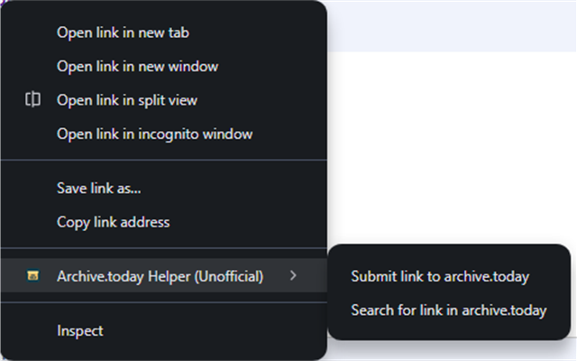

# Publication checklist

Release version: **1.0.1**. Upload package: `dist/archive-today-helper-1.0.1.zip`.

## Completed

- [x] Manifest V3 metadata, minimal permissions, and original extension icons.
- [x] Custom submit/search destinations with prefix, optional suffix, and encoding settings.
- [x] README, MIT license, privacy policy, security review, and listing copy.
- [x] Automated regression tests: 20 passing.
- [x] Manual Chrome confirmation that the revised submission and search actions work.
- [x] Upload ZIP generated using a file allowlist.

## Commit and publish the source

- [x] Stage the final versions of these files and directories:

  ```powershell
  git add .gitignore README.md PRIVACY.md SECURITY.md manifest.json background.js settings.js options.html options.css options.js icons scripts store tests
  ```

  This includes all icon PNGs and the SVG source, the PowerShell scripts, both test files, and the store documentation and promotional tile. LICENSE is already tracked and unchanged.
- [x] Review `git diff --cached --stat` and `git diff --cached`. Some files may already be staged from an earlier revision; the command above stages their final contents.
- [x] Commit, push, and make the GitHub repository public.
- [x] Enable GitHub private vulnerability reporting and confirm issues are available for support.

## Verify the extension

- [x] Load the final package in a clean Chrome profile and check that no extension errors are reported.
- [x] Verify a link containing `?a=1&b=2#section` reaches the intended submission form intact; check search results too.
- [x] Confirm no menu appears for `mailto:` or `javascript:` links.
- [x] Change each domain preference, reload options, and verify persistence. Check an alternate domain live if available.
- [x] Reload/update the extension and check both menus appear once.
- [x] Confirm the settings page is readable in light/dark mode and with keyboard navigation.
- [x] Test an upgrade from the old extension's settings.
- [x] Test a new, unarchived public URL you control if this was not included in prior manual testing. Complete Save/CAPTCHA if shown. See [submission research](SUBMISSION-RESEARCH.md).
- [x] Choose Custom for each action. Test prefix, optional suffix, and both encoding choices with a trusted HTTPS service. Save and reopen options to verify all values restore, then switch back to a preset.

## Prepare public assets and URLs

- [x] Verify the source, support, and [privacy policy](https://github.com/ebob9/archive_today_chrome_extension/blob/HEAD/PRIVACY.md) links without signing in. The policy must be publicly accessible before submitting for review.
- [x] Capture at least one actual Chrome screenshot of the right-click menu, ideally also the options page. Use 1280×800 or 640×400 pixels. Keep private URLs and personal browser details out of screenshots.
- [x] Use `icons/icon-128.png` as the store icon and `store/promo-440x280.png` as the required small promotional tile.
- [x] Review the title, description, attribution, privacy disclosures, and permission justifications in [LISTING.md](LISTING.md).

## Developer account

- [x] Register a Chrome Web Store developer account and pay the one-time registration fee if not already registered.
- [x] Set the publisher name and verify the contact email. Complete any additional account requirements shown in the dashboard.

## Package and submit

1. Run `powershell -NoProfile -File scripts/test.ps1`, then `powershell -NoProfile -File scripts/build.ps1` (PowerShell on Windows). The test script finds Node on PATH or an installed PyCharm agent runtime. If neither is available, install Node.js 18 or newer or supply `-NodePath "C:\path\to\node.exe"`. Building the ZIP itself does not require Node.js.
2. Upload `dist/archive-today-helper-1.0.1.zip` in the Chrome Web Store Developer Dashboard using your registered developer account.
3. Fill out the store listing from LISTING.md, add the required graphics, and enter the public homepage, support, and privacy-policy URLs.
4. Complete Privacy practices: single purpose, permission justifications, no remote code, and data disclosures consistent with PRIVACY.md. Selected links are sent to the selected service, including custom destinations; the developer collects no data.
5. Choose free pricing, intended countries, and public visibility in Distribution. Add the reviewer instructions below in Test instructions.
6. Review all dashboard certifications and submit for review. Choose automatic publication after approval or deferred publication as preferred.
7. After approval, add the actual store URL to README.md and create a GitHub release/tag for version 1.0.1. Increment the manifest version for subsequent extension updates.

## Reviewer instructions

No extension account or login is required. Install the extension and visit any page containing a normal HTTPS link. Right-click that link to see the two archive actions. Each opens a tab on archive.is by default. Open Extension options to change either domain. The archive service is external and may require a CAPTCHA, be unavailable, or have no snapshot of a particular link.

## Resubmit after a description rejection

For violation reference **Yellow Argon** (excessive keywords), replace the dashboard's detailed description with the revised **Detailed description** section in LISTING.md. The alternate-domain list has been removed. Copy only the description text, not the dashboard guidance or data-disclosure instructions.

1. Update the English (United States) description and any other localized descriptions containing the same domain list.
2. Save Draft and reopen the preview to confirm the list is gone.
3. Resubmit the corrected draft for review. The extension package and version do not need to change for this description-only correction.

If reviewer notes are available, use: "Removed the alternate-domain keyword list and shortened the description to explain the extension's features and privacy practices."

## Official references

- [Developer registration](https://developer.chrome.com/docs/webstore/register)
- [Account setup](https://developer.chrome.com/docs/webstore/set-up-account)
- [Publishing process](https://developer.chrome.com/docs/webstore/publish)
- [Required images and screenshot sizes](https://developer.chrome.com/docs/webstore/images)
- [Privacy practices dashboard](https://developer.chrome.com/docs/webstore/cws-dashboard-privacy)
- [Program policies](https://developer.chrome.com/docs/webstore/program-policies/policies)

Review the current dashboard and documentation at submission time.
